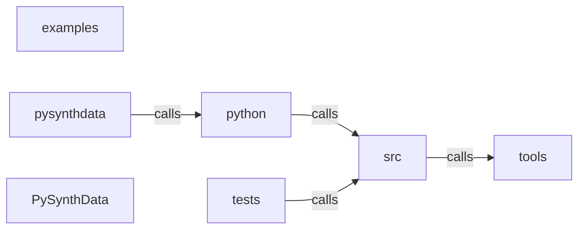

_Generated by CodeAtlas._

## Details

Architecture map of PySynthData.

### examples

Owns 0 symbols across 1 file(s).

**Related Classes/Methods:** _None_

### pysynthdata

Owns 15 symbols across 1 file(s).

**Related Classes/Methods:** _None_

**Source Files:**

- `pysynthdata/_mcp_tools.py`
  - `pysynthdata._mcp_tools.PySynthDataMCPHandler`
  - `pysynthdata._mcp_tools.PySynthDataMCPHandler.__init__`
  - `pysynthdata._mcp_tools.PySynthDataMCPHandler.anonymize_dataset`
  - `pysynthdata._mcp_tools.PySynthDataMCPHandler.augment_minority_class`
  - `pysynthdata._mcp_tools.PySynthDataMCPHandler.check_fairness_bias`
  - `pysynthdata._mcp_tools.PySynthDataMCPHandler.check_privacy_compliance`
  - `pysynthdata._mcp_tools.PySynthDataMCPHandler.debias_dataset`
  - `pysynthdata._mcp_tools.PySynthDataMCPHandler.detect_pii_exposure`
  - `pysynthdata._mcp_tools.PySynthDataMCPHandler.estimate_data_quality`
  - `pysynthdata._mcp_tools.PySynthDataMCPHandler.evaluate_synthetic_utility`
  - `pysynthdata._mcp_tools.PySynthDataMCPHandler.export_synthetic_data`
  - `pysynthdata._mcp_tools.PySynthDataMCPHandler.generate_synthetic_dataset`
  - `pysynthdata._mcp_tools.PySynthDataMCPHandler.validate_distribution_match`
  - `pysynthdata._mcp_tools.PySynthDataMCPTools`
  - `pysynthdata._mcp_tools.PySynthDataMCPTools.get_tools`

### python

Owns 0 symbols across 0 file(s).

**Related Classes/Methods:** _None_

### src

Owns 512 symbols across 17 file(s).

**Related Classes/Methods:** _None_

**Source Files:**

- `src/behaviors.rs`
  - `src.behaviors.AttributeSpec`
  - `src.behaviors.BehaviorModel`
  - `src.behaviors.BehaviorSimulator`
  - `src.behaviors.BehaviorSimulator.add_model`
  - `src.behaviors.BehaviorSimulator.generate_next_event`
  - `src.behaviors.BehaviorSimulator.new`
  - `src.behaviors.BehaviorSimulator.sample_transition`
  - `src.behaviors.BehaviorSimulator.simulate_entity`
  - `src.behaviors.EdgeCase`
  - `src.behaviors.EdgeCaseGenerator`
  - `src.behaviors.EdgeCaseGenerator.generate_account_edge_case`
  - `src.behaviors.EdgeCaseGenerator.generate_customer_edge_case`
  - `src.behaviors.EdgeCaseGenerator.generate_edge_cases`
  - `src.behaviors.EdgeCaseGenerator.generate_generic_edge_case`
  - `src.behaviors.EdgeCaseGenerator.generate_robot_edge_case`
  - `src.behaviors.EdgeCaseGenerator.generate_transaction_edge_case`
  - `src.behaviors.EdgeCaseGenerator.new`
  - `src.behaviors.EntityTimeSeries`
  - `src.behaviors.EventPattern`
  - `src.behaviors.FrequencyDistribution`
  - `src.behaviors.ScenarioBranch`
  - `src.behaviors.ScenarioBranch.add_intervention`
  - `src.behaviors.ScenarioBranch.add_outcome`
  - `src.behaviors.ScenarioBranch.new`
  - `src.behaviors.ScenarioSimulator`
  - `src.behaviors.ScenarioSimulator.branch_scenario`
  - `src.behaviors.ScenarioSimulator.simulate_intervention`
  - `src.behaviors.StateMachine`
  - `src.behaviors.StateSnapshot`
  - `src.behaviors.StateTransition`
  - `src.behaviors.TemporalRule`
  - `src.behaviors.TimedEvent`
  - `src.behaviors.tests.test_behavior_simulator`
  - `src.behaviors.tests.test_edge_case_generation`
  - `src.behaviors.tests.test_scenario_branching`
  - `src.behaviors.tests.test_scenario_intervention`
  - `src.behaviors.tests.test_state_machine_creation`
- `src/data_quality.rs`
  - `src.data_quality.DataQualityAnalyzer`
  - `src.data_quality.DataQualityAnalyzer.analyze`
  - `src.data_quality.DataQualityConfig`
  - `src.data_quality.DataQualityConfig.default`
  - `src.data_quality.DataQualityDegradation`
  - `src.data_quality.DataQualityDegradation.apply_quality_degradation`
  - `src.data_quality.DataQualityDegradation.inject_duplicates`
  - `src.data_quality.DataQualityDegradation.inject_inconsistencies`
  - `src.data_quality.DataQualityDegradation.inject_missing_values`
  - `src.data_quality.DataQualityDegradation.inject_outliers`
  - `src.data_quality.DataQualityDegradation.inject_temporal_inconsistencies`
  - `src.data_quality.DataQualityDegradation.inject_typos`
  - `src.data_quality.DataQualityDegradation.new`
  - `src.data_quality.DataQualityMetrics`
  - `src.data_quality.FieldQualityIssue`
  - `src.data_quality.OutlierPattern`
  - `src.data_quality.tests.test_analyze_detects_real_duplicates`
  - `src.data_quality.tests.test_data_quality_analyzer`
  - `src.data_quality.tests.test_inject_duplicates`
  - `src.data_quality.tests.test_inject_missing_values`
  - `src.data_quality.tests.test_inject_outliers_extreme`
  - `src.data_quality.tests.test_quality_config_defaults`
- `src/enterprise.rs`
  - `src.enterprise.AccessControlLevel`
  - `src.enterprise.AdvancedQualityMetrics`
  - `src.enterprise.AuditEvent`
  - `src.enterprise.AuditEventType`
  - `src.enterprise.ComplianceFramework`
  - `src.enterprise.ComplianceStatus`
  - `src.enterprise.ComplianceTag`
  - `src.enterprise.CostAndPerformanceTracker`
  - `src.enterprise.CostAndPerformanceTracker.add_estimate`
  - `src.enterprise.CostAndPerformanceTracker.add_profile`
  - `src.enterprise.CostAndPerformanceTracker.average_throughput`
  - `src.enterprise.CostAndPerformanceTracker.default`
  - `src.enterprise.CostAndPerformanceTracker.new`
  - `src.enterprise.CostAndPerformanceTracker.peak_memory`
  - `src.enterprise.CostAndPerformanceTracker.total_estimated_cost`
  - `src.enterprise.CostEstimate`
  - `src.enterprise.DataClassification`
  - `src.enterprise.DataGovernanceManager`
  - `src.enterprise.DataGovernanceManager.add_policy`
  - `src.enterprise.DataGovernanceManager.audit_access`
  - `src.enterprise.DataGovernanceManager.default`
  - `src.enterprise.DataGovernanceManager.get_audit_trail`
  - `src.enterprise.DataGovernanceManager.get_policy`
  - `src.enterprise.DataGovernanceManager.new`
  - `src.enterprise.DataGovernancePolicy`
  - `src.enterprise.DataLineage`
  - `src.enterprise.DataProvenance`
  - `src.enterprise.EventStatus`
  - `src.enterprise.GDPRCompliance`
  - `src.enterprise.GenerationConfig`
  - `src.enterprise.GenerationMethod`
  - `src.enterprise.HIPAACompliance`
  - `src.enterprise.IssueSeverity`
  - `src.enterprise.LineageSource`
  - `src.enterprise.MigrationDetails`
  - `src.enterprise.PerformanceProfile`
  - `src.enterprise.ProvenanceTracker`
  - `src.enterprise.ProvenanceTracker.default`
  - `src.enterprise.ProvenanceTracker.get_provenance`
  - `src.enterprise.ProvenanceTracker.is_reproducible`
  - `src.enterprise.ProvenanceTracker.new`
  - `src.enterprise.ProvenanceTracker.record_generation`
  - `src.enterprise.QualityIssue`
  - `src.enterprise.QualityScorecard`
  - `src.enterprise.RegulatoryFinding`
  - `src.enterprise.RegulatoryReport`
  - `src.enterprise.RegulatoryReportGenerator`
  - `src.enterprise.RegulatoryReportGenerator.generate_gdpr_report`
  - `src.enterprise.RegulatoryReportGenerator.generate_hipaa_report`
  - `src.enterprise.RegulatoryReportGenerator.generate_soc2_report`
  - `src.enterprise.SOC2Compliance`
  - `src.enterprise.Transformation`
  - `src.enterprise.tests.test_cost_tracking`
  - `src.enterprise.tests.test_data_lineage_creation`
  - `src.enterprise.tests.test_governance_manager`
  - `src.enterprise.tests.test_provenance_tracking`
  - `src.enterprise.tests.test_regulatory_report_generation`
- `src/errors.rs`
  - `src.errors.WorldCompilerError`
- `src/generator.rs`
  - `src.generator.GeneratedWorld`
  - `src.generator.GeneratedWorld.to_json`
  - `src.generator.QualityReport`
  - `src.generator.QualityReport.total_violations`
  - `src.generator.WorldGenerator`
  - `src.generator.WorldGenerator.evaluate`
  - `src.generator.WorldGenerator.generate`
  - `src.generator.WorldGenerator.generate_streaming`
  - `src.generator.WorldGenerator.new`
  - `src.generator.WorldGenerator.schema`
  - `src.generator.WorldMetadata`
  - `src.generator.constraint_satisfied`
  - `src.generator.generate_datetime`
  - `src.generator.generate_field_value`
  - `src.generator.generate_json_value`
  - `src.generator.generate_row`
  - `src.generator.generate_string_value`
  - `src.generator.generate_uuid`
  - `src.generator.index_constraints`
  - `src.generator.index_relationships`
  - `src.generator.parse_numeric_range`
  - `src.generator.pick`
  - `src.generator.tests.create_test_schema`
  - `src.generator.tests.test_evaluate_reports_no_violations_on_clean_generation`
  - `src.generator.tests.test_foreign_key_generation_uses_parent_values`
  - `src.generator.tests.test_generate_basic`
  - `src.generator.tests.test_generate_deterministic_with_seed`
  - `src.generator.tests.test_generate_respects_range_constraint`
  - `src.generator.tests.test_generate_streaming_retains_fk_parent_but_not_leaf_entity`
  - `src.generator.tests.test_generate_streaming_yields_same_rows_as_generate`
  - `src.generator.tests.test_generate_unique_ids`
  - `src.generator.tests.test_generator_creation`
  - `src.generator.topological_order`
  - `src.generator.uniquify`
- `src/lib.rs`
  - `src.lib.PyAuditEvent`
  - `src.lib.PyAuditEvent.__repr__`
  - `src.lib.PyAuditEvent.event_type`
  - `src.lib.PyAuditEvent.new`
  - `src.lib.PyAuditEvent.timestamp`
  - `src.lib.PyAuditEventType`
  - `src.lib.PyAuditEventType.compliance_check`
  - `src.lib.PyAuditEventType.data_access`
  - `src.lib.PyAuditEventType.data_modification`
  - `src.lib.PyAuditEventType.policy_change`
  - `src.lib.PyDataGovernanceManager`
  - `src.lib.PyDataGovernanceManager.create_policy`
  - `src.lib.PyDataGovernanceManager.get_policy`
  - `src.lib.PyDataGovernanceManager.new`
  - `src.lib.PyDataGovernancePolicy`
  - `src.lib.PyDataGovernancePolicy.__repr__`
  - `src.lib.PyDataGovernancePolicy.name`
  - `src.lib.PyDataGovernancePolicy.new`
  - `src.lib.PyDataQualityAnalyzer`
  - `src.lib.PyDataQualityAnalyzer.__repr__`
  - `src.lib.PyDataQualityAnalyzer.analyze`
  - `src.lib.PyDataQualityAnalyzer.new`
  - `src.lib.PyDataQualityMetrics`
  - `src.lib.PyDataQualityMetrics.__repr__`
  - `src.lib.PyDataQualityMetrics.new`
  - `src.lib.PyOutlierPattern`
  - `src.lib.PyOutlierPattern.isolation_forest`
  - `src.lib.PyOutlierPattern.local_outlier_factor`
  - `src.lib.PyOutlierPattern.statistical`
  - `src.lib.PyPrivacyBudget`
  - `src.lib.PyPrivacyBudget.__repr__`
  - `src.lib.PyPrivacyBudget.is_exhausted`
  - `src.lib.PyPrivacyBudget.new`
  - `src.lib.PyPrivacyBudget.remaining_delta`
  - `src.lib.PyPrivacyBudget.remaining_epsilon`
  - `src.lib.PyPrivacyBudget.spent_delta`
  - `src.lib.PyPrivacyBudget.spent_epsilon`
  - `src.lib.PyPrivacyBudget.total_delta`
  - `src.lib.PyPrivacyBudget.total_epsilon`
  - `src.lib.PySchema`
  - `src.lib.PySchema.add_constraint`
  - `src.lib.PySchema.add_entity`
  - `src.lib.PySchema.add_field`
  - `src.lib.PySchema.add_relationship`
  - `src.lib.PySchema.entity_names`
  - `src.lib.PySchema.from_yaml`
  - `src.lib.PySchema.from_yaml_str`
  - `src.lib.PySchema.new`
  - `src.lib.PySchema.to_json`
  - `src.lib.PySchema.to_yaml`
  - `src.lib.PyWorldGenerator`
  - `src.lib.PyWorldGenerator.generate`
  - `src.lib.PyWorldGenerator.generate_private`
  - `src.lib.PyWorldGenerator.generate_streaming`
  - `src.lib.PyWorldGenerator.new`
  - `src.lib.json_to_py`
  - `src.lib.parse_cardinality`
  - `src.lib.parse_constraint_type`
  - `src.lib.parse_field_type`
  - `src.lib.pysynthdata`
  - `src.lib.value_error`
- `src/monitoring.rs`
  - `src.monitoring.AlertSeverity`
  - `src.monitoring.AlertSummary`
  - `src.monitoring.AlertThresholds`
  - `src.monitoring.AlertThresholds.default`
  - `src.monitoring.AnomalyDetection`
  - `src.monitoring.AnomalyDetector`
  - `src.monitoring.AnomalyDetector.clear_anomalies`
  - `src.monitoring.AnomalyDetector.default`
  - `src.monitoring.AnomalyDetector.detect_format_anomaly`
  - `src.monitoring.AnomalyDetector.detect_major_anomaly`
  - `src.monitoring.AnomalyDetector.detect_minor_anomaly`
  - `src.monitoring.AnomalyDetector.detect_outlier`
  - `src.monitoring.AnomalyDetector.detect_pattern_break`
  - `src.monitoring.AnomalyDetector.get_anomalies`
  - `src.monitoring.AnomalyDetector.get_anomalies_by_type`
  - `src.monitoring.AnomalyDetector.get_anomaly_summary`
  - `src.monitoring.AnomalyDetector.get_high_confidence_anomalies`
  - `src.monitoring.AnomalyDetector.new`
  - `src.monitoring.AnomalySummary`
  - `src.monitoring.AnomalyType`
  - `src.monitoring.DriftAlert`
  - `src.monitoring.DriftDetector`
  - `src.monitoring.DriftDetector.check_constraint_violations`
  - `src.monitoring.DriftDetector.check_data_drift`
  - `src.monitoring.DriftDetector.check_edge_case_frequency`
  - `src.monitoring.DriftDetector.check_schema_drift`
  - `src.monitoring.DriftDetector.check_temporal_anomalies`
  - `src.monitoring.DriftDetector.clear_alerts`
  - `src.monitoring.DriftDetector.default`
  - `src.monitoring.DriftDetector.detect_drift`
  - `src.monitoring.DriftDetector.get_alert_summary`
  - `src.monitoring.DriftDetector.get_alerts`
  - `src.monitoring.DriftDetector.new`
  - `src.monitoring.DriftDetector.set_baseline`
  - `src.monitoring.DriftMetrics`
  - `src.monitoring.DriftType`
  - `src.monitoring.MonitoringConfig`
  - `src.monitoring.PerformanceMetric`
  - `src.monitoring.PerformanceMonitor`
  - `src.monitoring.PerformanceMonitor.default`
  - `src.monitoring.PerformanceMonitor.get_average_latency`
  - `src.monitoring.PerformanceMonitor.get_fastest`
  - `src.monitoring.PerformanceMonitor.get_slowest`
  - `src.monitoring.PerformanceMonitor.get_throughput`
  - `src.monitoring.PerformanceMonitor.new`
  - `src.monitoring.PerformanceMonitor.record_operation`
  - `src.monitoring.tests.test_alert_summary`
  - `src.monitoring.tests.test_drift_detection_schema`
  - `src.monitoring.tests.test_enable_monitoring`
  - `src.monitoring.tests.test_monitoring_config_defaults`
  - `src.monitoring.tests.test_performance_extremes`
  - `src.monitoring.tests.test_performance_monitor`
- `src/multimodal_augmentation.rs`
  - `src.multimodal_augmentation.AudioAugmentor`
  - `src.multimodal_augmentation.AudioAugmentor.available_augmentations`
  - `src.multimodal_augmentation.AudioAugmentor.generate`
  - `src.multimodal_augmentation.Modality`
  - `src.multimodal_augmentation.MultiModalAugmentationPipeline`
  - `src.multimodal_augmentation.MultiModalAugmentationPipeline.default`
  - `src.multimodal_augmentation.MultiModalAugmentationPipeline.generate_all`
  - `src.multimodal_augmentation.MultiModalAugmentationPipeline.get_generation_stats`
  - `src.multimodal_augmentation.MultiModalAugmentationPipeline.new`
  - `src.multimodal_augmentation.MultiModalSample`
  - `src.multimodal_augmentation.MultiModalSample.new`
  - `src.multimodal_augmentation.SensorAugmentor`
  - `src.multimodal_augmentation.SensorAugmentor.available_augmentations`
  - `src.multimodal_augmentation.SensorAugmentor.generate`
  - `src.multimodal_augmentation.TemporalAugmentor`
  - `src.multimodal_augmentation.TemporalAugmentor.available_augmentations`
  - `src.multimodal_augmentation.TemporalAugmentor.generate`
  - `src.multimodal_augmentation.VisionAugmentor`
  - `src.multimodal_augmentation.VisionAugmentor.available_augmentations`
  - `src.multimodal_augmentation.VisionAugmentor.generate`
  - `src.multimodal_augmentation.tests.test_audio_augmentation`
  - `src.multimodal_augmentation.tests.test_multimodal_sample_creation`
  - `src.multimodal_augmentation.tests.test_pipeline_generation`
  - `src.multimodal_augmentation.tests.test_sensor_augmentation`
  - `src.multimodal_augmentation.tests.test_temporal_augmentation`
  - `src.multimodal_augmentation.tests.test_vision_augmentation`
- `src/parser.rs`
  - `src.parser.SchemaParser`
  - `src.parser.SchemaParser.from_parsed`
  - `src.parser.SchemaParser.from_yaml`
  - `src.parser.SchemaParser.from_yaml_string`
  - `src.parser.SchemaParser.parse_field_type`
  - `src.parser.YamlConstraint`
  - `src.parser.YamlEntity`
  - `src.parser.YamlField`
  - `src.parser.YamlRelationship`
  - `src.parser.YamlSchema`
  - `src.parser.tests.test_parse_field_type_enum_preserves_declared_casing`
  - `src.parser.tests.test_parse_field_type_primitives`
  - `src.parser.tests.test_parse_from_yaml_string`
- `src/privacy.rs`
  - `src.privacy.PrivacyBudget`
  - `src.privacy.PrivacyBudget.is_exhausted`
  - `src.privacy.PrivacyBudget.new`
  - `src.privacy.PrivacyBudget.remaining_delta`
  - `src.privacy.PrivacyBudget.remaining_epsilon`
  - `src.privacy.PrivacyBudget.spend`
  - `src.privacy.PrivacyBudget.spent_delta`
  - `src.privacy.PrivacyBudget.spent_epsilon`
  - `src.privacy.PrivacyBudget.total_delta`
  - `src.privacy.PrivacyBudget.total_epsilon`
  - `src.privacy.PrivacyReport`
  - `src.privacy.observed_spread`
  - `src.privacy.parse_range`
  - `src.privacy.privatize_numeric`
  - `src.privacy.privatize_world`
  - `src.privacy.sample_laplace`
  - `src.privacy.tests.budget_rejects_invalid_construction`
  - `src.privacy.tests.budget_rejects_overspend`
  - `src.privacy.tests.budget_tracks_spend_and_remaining`
  - `src.privacy.tests.laplace_noise_is_zero_centered_over_many_samples`
  - `src.privacy.tests.privatize_numeric_returns_unmodified_value_for_invalid_params`
- `src/real_world_mess.rs`
  - `src.real_world_mess.MessAnalysis`
  - `src.real_world_mess.MessAnalysis.new`
  - `src.real_world_mess.RealWorldMessConfig`
  - `src.real_world_mess.RealWorldMessConfig.default`
  - `src.real_world_mess.RealWorldMessGenerator`
  - `src.real_world_mess.RealWorldMessGenerator.apply_real_world_mess`
  - `src.real_world_mess.RealWorldMessGenerator.inject_cascading_errors`
  - `src.real_world_mess.RealWorldMessGenerator.inject_copy_paste_truncation`
  - `src.real_world_mess.RealWorldMessGenerator.inject_decimal_chaos`
  - `src.real_world_mess.RealWorldMessGenerator.inject_encoding_chaos`
  - `src.real_world_mess.RealWorldMessGenerator.inject_fat_finger_errors`
  - `src.real_world_mess.RealWorldMessGenerator.inject_field_swaps`
  - `src.real_world_mess.RealWorldMessGenerator.inject_legacy_id_formats`
  - `src.real_world_mess.RealWorldMessGenerator.inject_null_chaos`
  - `src.real_world_mess.RealWorldMessGenerator.inject_orphaned_fks`
  - `src.real_world_mess.RealWorldMessGenerator.inject_partial_batches`
  - `src.real_world_mess.RealWorldMessGenerator.inject_partial_writes`
  - `src.real_world_mess.RealWorldMessGenerator.inject_rounding_errors`
  - `src.real_world_mess.RealWorldMessGenerator.inject_schema_version_mix`
  - `src.real_world_mess.RealWorldMessGenerator.inject_sensor_drift`
  - `src.real_world_mess.RealWorldMessGenerator.inject_timezone_confusion`
  - `src.real_world_mess.RealWorldMessGenerator.inject_type_conversion_failures`
  - `src.real_world_mess.RealWorldMessGenerator.inject_unit_confusion`
  - `src.real_world_mess.RealWorldMessGenerator.inject_update_typos`
  - `src.real_world_mess.RealWorldMessGenerator.inject_y2k_bugs`
  - `src.real_world_mess.RealWorldMessGenerator.new`
  - `src.real_world_mess.tests.test_config_all_enabled`
  - `src.real_world_mess.tests.test_decimal_chaos`
  - `src.real_world_mess.tests.test_legacy_ids`
  - `src.real_world_mess.tests.test_null_chaos`
- `src/research.rs`
  - `src.research.BehaviorPattern`
  - `src.research.ConstraintPattern`
  - `src.research.DomainKnowledgeBase`
  - `src.research.DomainKnowledgeBase.add_banking_domain`
  - `src.research.DomainKnowledgeBase.add_custom_domain`
  - `src.research.DomainKnowledgeBase.add_healthcare_domain`
  - `src.research.DomainKnowledgeBase.add_insurance_domain`
  - `src.research.DomainKnowledgeBase.add_manufacturing_domain`
  - `src.research.DomainKnowledgeBase.add_robotics_domain`
  - `src.research.DomainKnowledgeBase.default`
  - `src.research.DomainKnowledgeBase.get_domain`
  - `src.research.DomainKnowledgeBase.initialize_default_domains`
  - `src.research.DomainKnowledgeBase.list_domains`
  - `src.research.DomainKnowledgeBase.new`
  - `src.research.DomainResearch`
  - `src.research.EdgeCasePattern`
  - `src.research.EdgeCaseSeverity`
  - `src.research.EntityArchetype`
  - `src.research.FieldArchetype`
  - `src.research.RelationshipPattern`
  - `src.research.ResearchMetadata`
  - `src.research.SchemaInferenceEngine`
  - `src.research.SchemaInferenceEngine.infer_entities_from_text`
  - `src.research.SchemaInferenceEngine.infer_from_description`
  - `src.research.StateTransition`
  - `src.research.tests.test_entity_inference`
  - `src.research.tests.test_knowledge_base_creation`
  - `src.research.tests.test_list_domains`
  - `src.research.tests.test_schema_inference_banking`
- `src/robotics.rs`
  - `src.robotics.AllocationStrategy`
  - `src.robotics.CollisionDetector`
  - `src.robotics.CollisionDetector.check_path_collision`
  - `src.robotics.CollisionDetector.detect_collision`
  - `src.robotics.CollisionDetector.new`
  - `src.robotics.Environment`
  - `src.robotics.EnvironmentType`
  - `src.robotics.FleetCoordinator`
  - `src.robotics.FleetCoordinator.allocate_auction`
  - `src.robotics.FleetCoordinator.allocate_consensus`
  - `src.robotics.FleetCoordinator.allocate_greedy`
  - `src.robotics.FleetCoordinator.allocate_tasks`
  - `src.robotics.FleetCoordinator.find_nearest_available_robot`
  - `src.robotics.FleetCoordinator.new`
  - `src.robotics.FleetSimulation`
  - `src.robotics.FleetSimulation.add_robot`
  - `src.robotics.FleetSimulation.add_sensor_reading`
  - `src.robotics.FleetSimulation.add_task`
  - `src.robotics.FleetSimulation.get_robot`
  - `src.robotics.FleetSimulation.get_robot_mut`
  - `src.robotics.FleetSimulation.new`
  - `src.robotics.FleetSimulation.num_readings`
  - `src.robotics.FleetSimulation.num_robots`
  - `src.robotics.FleetSimulation.num_tasks`
  - `src.robotics.Landmark`
  - `src.robotics.Obstacle`
  - `src.robotics.ObstacleType`
  - `src.robotics.Robot`
  - `src.robotics.RobotStatus`
  - `src.robotics.RobotType`
  - `src.robotics.SensorData`
  - `src.robotics.SensorReading`
  - `src.robotics.SensorType`
  - `src.robotics.Task`
  - `src.robotics.TaskStatus`
  - `src.robotics.TaskType`
  - `src.robotics.tests.test_add_robot`
  - `src.robotics.tests.test_collision_detection`
  - `src.robotics.tests.test_fleet_coordinator_greedy`
  - `src.robotics.tests.test_fleet_simulation_creation`
- `src/ros2_bridge.rs`
  - `src.ros2_bridge.LocalController`
  - `src.ros2_bridge.LocalController.compute_velocity`
  - `src.ros2_bridge.LocalController.default`
  - `src.ros2_bridge.LocalController.new`
  - `src.ros2_bridge.NavStack`
  - `src.ros2_bridge.NavStack.compute_velocity`
  - `src.ros2_bridge.NavStack.default`
  - `src.ros2_bridge.NavStack.new`
  - `src.ros2_bridge.NavStack.plan_path`
  - `src.ros2_bridge.PathPlanner`
  - `src.ros2_bridge.PathPlanner.default`
  - `src.ros2_bridge.PathPlanner.new`
  - `src.ros2_bridge.PathPlanner.plan`
  - `src.ros2_bridge.ROS2Message`
  - `src.ros2_bridge.ROS2MessageType`
  - `src.ros2_bridge.ROS2Publisher`
  - `src.ros2_bridge.ROS2Publisher.get_all`
  - `src.ros2_bridge.ROS2Publisher.get_latest`
  - `src.ros2_bridge.ROS2Publisher.new`
  - `src.ros2_bridge.ROS2Publisher.publish`
  - `src.ros2_bridge.ROS2SimulatorBridge`
  - `src.ros2_bridge.ROS2SimulatorBridge.create_publisher`
  - `src.ros2_bridge.ROS2SimulatorBridge.default`
  - `src.ros2_bridge.ROS2SimulatorBridge.get_message_count`
  - `src.ros2_bridge.ROS2SimulatorBridge.get_publisher`
  - `src.ros2_bridge.ROS2SimulatorBridge.list_topics`
  - `src.ros2_bridge.ROS2SimulatorBridge.new`
  - `src.ros2_bridge.ROS2SimulatorBridge.publish_message`
  - `src.ros2_bridge.ROS2SimulatorBridge.subscribe`
  - `src.ros2_bridge.tests.test_local_controller`
  - `src.ros2_bridge.tests.test_path_planner`
  - `src.ros2_bridge.tests.test_publish_message`
  - `src.ros2_bridge.tests.test_ros2_bridge_creation`
  - `src.ros2_bridge.tests.test_ros2_publisher_creation`
- `src/schema.rs`
  - `src.schema.Cardinality`
  - `src.schema.Constraint`
  - `src.schema.ConstraintType`
  - `src.schema.Entity`
  - `src.schema.Field`
  - `src.schema.FieldType`
  - `src.schema.Relationship`
  - `src.schema.Schema`
  - `src.schema.Schema.add_constraint`
  - `src.schema.Schema.add_entity`
  - `src.schema.Schema.add_field`
  - `src.schema.Schema.add_relationship`
  - `src.schema.Schema.default`
  - `src.schema.Schema.new`
  - `src.schema.Schema.to_json`
  - `src.schema.Schema.to_yaml`
  - `src.schema.Schema.validate`
  - `src.schema.tests.test_add_entity`
  - `src.schema.tests.test_schema_creation`
  - `src.schema.tests.test_schema_validation_missing_entity`
- `src/unconventional_data.rs`
  - `src.unconventional_data.AssumptionChallenge`
  - `src.unconventional_data.DataAssumptionChallenges`
  - `src.unconventional_data.DataAssumptionChallenges.common_assumptions`
  - `src.unconventional_data.DataAssumptionChallenges.generate_challenge_dataset`
  - `src.unconventional_data.UnconventionalDataGenerator`
  - `src.unconventional_data.UnconventionalDataGenerator.add_pattern`
  - `src.unconventional_data.UnconventionalDataGenerator.apply_unconventional_patterns`
  - `src.unconventional_data.UnconventionalDataGenerator.generate_all_outliers`
  - `src.unconventional_data.UnconventionalDataGenerator.generate_benford_law_violation`
  - `src.unconventional_data.UnconventionalDataGenerator.generate_constraint_violation`
  - `src.unconventional_data.UnconventionalDataGenerator.generate_grammar_violation`
  - `src.unconventional_data.UnconventionalDataGenerator.generate_impossible_correlation`
  - `src.unconventional_data.UnconventionalDataGenerator.generate_impossible_transition`
  - `src.unconventional_data.UnconventionalDataGenerator.generate_inverted_distribution`
  - `src.unconventional_data.UnconventionalDataGenerator.generate_language_shift`
  - `src.unconventional_data.UnconventionalDataGenerator.generate_logical_contradiction`
  - `src.unconventional_data.UnconventionalDataGenerator.generate_multimodal_distribution`
  - `src.unconventional_data.UnconventionalDataGenerator.generate_no_outliers`
  - `src.unconventional_data.UnconventionalDataGenerator.generate_perfect_negative_correlation`
  - `src.unconventional_data.UnconventionalDataGenerator.generate_reverse_time_series`
  - `src.unconventional_data.UnconventionalDataGenerator.generate_symmetric_outliers`
  - `src.unconventional_data.UnconventionalDataGenerator.generate_unit_conflict`
  - `src.unconventional_data.UnconventionalDataGenerator.generate_zero_entropy`
  - `src.unconventional_data.UnconventionalDataGenerator.new`
  - `src.unconventional_data.UnconventionalDataPattern`
  - `src.unconventional_data.UnconventionalPattern`
  - `src.unconventional_data.tests.test_all_outliers`
  - `src.unconventional_data.tests.test_assumption_challenges`
  - `src.unconventional_data.tests.test_multimodal_distribution`
  - `src.unconventional_data.tests.test_perfect_negative_correlation`
  - `src.unconventional_data.tests.test_zero_entropy`
- `src/validation.rs`
  - `src.validation.ValidationResult`
  - `src.validation.Validator`
  - `src.validation.Validator.validate`
  - `src.validation.tests.test_validator_creation`

### tests

Owns 70 symbols across 8 file(s).

**Related Classes/Methods:** _None_

**Source Files:**

- `tests/test_behaviors.rs`
  - `tests.test_behaviors.test_behavior_model_creation`
  - `tests.test_behaviors.test_behavior_simulator_init`
  - `tests.test_behaviors.test_edge_case_generation_customer`
  - `tests.test_behaviors.test_edge_case_generation_robot`
  - `tests.test_behaviors.test_frequency_distribution`
  - `tests.test_behaviors.test_intervention_simulation`
  - `tests.test_behaviors.test_scenario_creation`
  - `tests.test_behaviors.test_state_machine_simulation`
  - `tests.test_behaviors.test_state_snapshot`
  - `tests.test_behaviors.test_timed_event`
- `tests/test_codeatlas_adapter.py`
  - `tests.test_codeatlas_adapter._run`
  - `tests.test_codeatlas_adapter.test_check_reports_the_embedded_engine_available`
  - `tests.test_codeatlas_adapter.test_diagnose_summarises_the_architecture_map`
  - `tests.test_codeatlas_adapter.test_explain_reports_an_unknown_node_as_an_error`
  - `tests.test_codeatlas_adapter.test_god_nodes_are_ranked_by_degree`
- `tests/test_monitoring.rs`
  - `tests.test_monitoring.test_alert_summary`
  - `tests.test_monitoring.test_anomalies_by_type`
  - `tests.test_monitoring.test_anomaly_summary`
  - `tests.test_monitoring.test_clear_anomalies`
  - `tests.test_monitoring.test_constraint_violation_alert`
  - `tests.test_monitoring.test_custom_thresholds`
  - `tests.test_monitoring.test_data_drift_detection`
  - `tests.test_monitoring.test_drift_detector_init`
  - `tests.test_monitoring.test_edge_case_frequency_alert`
  - `tests.test_monitoring.test_enable_all_monitoring`
  - `tests.test_monitoring.test_format_anomaly_detection`
  - `tests.test_monitoring.test_high_confidence_anomalies`
  - `tests.test_monitoring.test_major_anomaly_detection`
  - `tests.test_monitoring.test_minor_anomaly_detection`
  - `tests.test_monitoring.test_monitoring_config_defaults`
  - `tests.test_monitoring.test_multiple_drift_alerts`
  - `tests.test_monitoring.test_outlier_detection`
  - `tests.test_monitoring.test_pattern_break_detection`
  - `tests.test_monitoring.test_performance_extremes`
  - `tests.test_monitoring.test_performance_monitor_latency`
  - `tests.test_monitoring.test_performance_monitor_throughput`
  - `tests.test_monitoring.test_schema_drift_detection`
- `tests/test_parser.rs`
  - `tests.test_parser.test_parse_enum_type`
  - `tests.test_parser.test_parse_invalid_schema`
  - `tests.test_parser.test_parse_simple_schema`
  - `tests.test_parser.test_parse_with_relationships`
- `tests/test_research.rs`
  - `tests.test_research.test_add_custom_domain`
  - `tests.test_research.test_edge_case_severity`
  - `tests.test_research.test_entity_inference_from_text`
  - `tests.test_research.test_get_banking_domain`
  - `tests.test_research.test_get_robotics_domain`
  - `tests.test_research.test_knowledge_base_init`
  - `tests.test_research.test_schema_inference_banking`
  - `tests.test_research.test_schema_inference_robotics`
- `tests/test_robotics.rs`
  - `tests.test_robotics.test_add_multiple_robots`
  - `tests.test_robotics.test_collision_detection_false`
  - `tests.test_robotics.test_collision_detection_true`
  - `tests.test_robotics.test_create_fleet_simulation`
  - `tests.test_robotics.test_path_collision`
  - `tests.test_robotics.test_task_allocation`
- `tests/test_ros2_bridge.rs`
  - `tests.test_ros2_bridge.test_local_controller_at_goal`
  - `tests.test_ros2_bridge.test_local_controller_moving`
  - `tests.test_ros2_bridge.test_nav_stack_integration`
  - `tests.test_ros2_bridge.test_path_planner`
  - `tests.test_ros2_bridge.test_publish_and_retrieve`
  - `tests.test_ros2_bridge.test_publish_via_bridge`
  - `tests.test_ros2_bridge.test_queue_size_limit`
  - `tests.test_ros2_bridge.test_ros2_bridge_publisher_management`
  - `tests.test_ros2_bridge.test_ros2_publisher_init`
- `tests/test_schema.rs`
  - `tests.test_schema.test_schema_add_entity`
  - `tests.test_schema.test_schema_add_field`
  - `tests.test_schema.test_schema_add_relationship`
  - `tests.test_schema.test_schema_validation_missing_entity`
  - `tests.test_schema.test_schema_validation_success`
  - `tests.test_schema.test_schema_yaml_serialization`

### tools

Owns 0 symbols across 0 file(s).

**Related Classes/Methods:** _None_

### PySynthData

Owns 0 symbols across 11 file(s).

**Related Classes/Methods:** _None_
