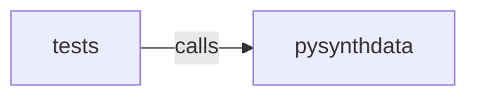

_Generated by CodeAtlas._

## Details

Owns 0 symbols across 0 file(s).

### pysynthdata

Owns 54 symbols across 5 file(s).

**Related Classes/Methods:** _None_

**Source Files:**

- `python/pysynthdata/api.py`
  - `python.pysynthdata.api.GeneratedWorld`
  - `python.pysynthdata.api.GeneratedWorld.__init__`
  - `python.pysynthdata.api.GeneratedWorld.constraint_violations`
  - `python.pysynthdata.api.GeneratedWorld.fidelity_score`
  - `python.pysynthdata.api.GeneratedWorld.privacy_report`
  - `python.pysynthdata.api.GeneratedWorld.quality_report`
  - `python.pysynthdata.api.GeneratedWorld.to_json`
  - `python.pysynthdata.api.GeneratedWorld.to_pandas`
  - `python.pysynthdata.api.GeneratedWorld.to_parquet`
  - `python.pysynthdata.api.PrivacyBudget`
  - `python.pysynthdata.api.PrivacyBudget.__init__`
  - `python.pysynthdata.api.PrivacyBudget.__repr__`
  - `python.pysynthdata.api.PrivacyBudget.is_exhausted`
  - `python.pysynthdata.api.PrivacyBudget.remaining_delta`
  - `python.pysynthdata.api.PrivacyBudget.remaining_epsilon`
  - `python.pysynthdata.api.PrivacyBudget.spent_delta`
  - `python.pysynthdata.api.PrivacyBudget.spent_epsilon`
  - `python.pysynthdata.api.PrivacyBudget.total_delta`
  - `python.pysynthdata.api.PrivacyBudget.total_epsilon`
  - `python.pysynthdata.api.Schema`
  - `python.pysynthdata.api.Schema.__init__`
  - `python.pysynthdata.api.Schema.add_constraint`
  - `python.pysynthdata.api.Schema.add_entity`
  - `python.pysynthdata.api.Schema.add_field`
  - `python.pysynthdata.api.Schema.add_relationship`
  - `python.pysynthdata.api.Schema.entities`
  - `python.pysynthdata.api.Schema.from_yaml`
  - `python.pysynthdata.api.Schema.from_yaml_str`
  - `python.pysynthdata.api.Schema.load_from_yaml`
  - `python.pysynthdata.api.Schema.to_dict`
  - `python.pysynthdata.api.Schema.to_json`
  - `python.pysynthdata.api.Schema.to_yaml`
  - `python.pysynthdata.api.WorldGenerator`
  - `python.pysynthdata.api.WorldGenerator.__init__`
  - `python.pysynthdata.api.WorldGenerator.from_yaml`
  - `python.pysynthdata.api.WorldGenerator.generate`
  - `python.pysynthdata.api.WorldGenerator.generate_private`
  - `python.pysynthdata.api.WorldGenerator.generate_streaming`
  - `python.pysynthdata.api.WorldGenerator.generate_streaming.on_chunk`
  - `python.pysynthdata.api.WorldGenerator.generate_streaming.worker`
  - `python.pysynthdata.api.WorldGenerator.to_parquet_streaming`
  - `python.pysynthdata.api.WorldGenerator.to_parquet_streaming.on_chunk`
  - `python.pysynthdata.api.load_schema`
  - `python.pysynthdata.api.load_schema_json`
  - `python.pysynthdata.api.load_schema_yaml`
- `python/pysynthdata/cli.py`
  - `python.pysynthdata.cli._cmd_infer_schema`
  - `python.pysynthdata.cli.build_parser`
  - `python.pysynthdata.cli.main`
- `python/pysynthdata/db_schema.py`
  - `python.pysynthdata.db_schema._map_column_type`
  - `python.pysynthdata.db_schema._table_entity`
  - `python.pysynthdata.db_schema._table_relationships`
  - `python.pysynthdata.db_schema.infer_schema`
  - `python.pysynthdata.db_schema.infer_schema_to_file`
  - `python.pysynthdata.db_schema.infer_schema_yaml`

### tests

Owns 29 symbols across 3 file(s).

**Related Classes/Methods:** _None_

**Source Files:**

- `python/tests/test_db_schema.py`
  - `python.tests.test_db_schema.sqlite_db`
  - `python.tests.test_db_schema.test_cli_infer_schema_reports_missing_table_error`
  - `python.tests.test_db_schema.test_cli_infer_schema_writes_expected_file`
  - `python.tests.test_db_schema.test_infer_all_tables_detects_foreign_key_relationship`
  - `python.tests.test_db_schema.test_infer_schema_to_file_writes_yaml_to_disk`
  - `python.tests.test_db_schema.test_infer_schema_yaml_round_trips_through_real_yaml_parser`
  - `python.tests.test_db_schema.test_infer_single_table_columns_types_pk_unique_nullable`
  - `python.tests.test_db_schema.test_inferred_schema_generates_real_rows_via_rust_core`
  - `python.tests.test_db_schema.test_missing_table_raises_clear_error`
  - `python.tests.test_db_schema.test_requires_exactly_one_of_table_or_all_tables`
- `python/tests/test_enum_casing.py`
  - `python.tests.test_enum_casing.test_add_field_preserves_declared_enum_casing`
- `python/tests/test_privacy_and_streaming.py`
  - `python.tests.test_privacy_and_streaming.TestGeneratePrivate`
  - `python.tests.test_privacy_and_streaming.TestGeneratePrivate.test_noised_values_still_respect_declared_range_constraint`
  - `python.tests.test_privacy_and_streaming.TestGeneratePrivate.test_overspend_raises_and_leaves_budget_unchanged`
  - `python.tests.test_privacy_and_streaming.TestGeneratePrivate.test_plain_generate_has_no_privacy_report`
  - `python.tests.test_privacy_and_streaming.TestGeneratePrivate.test_returns_privacy_report`
  - `python.tests.test_privacy_and_streaming.TestGeneratePrivate.test_schema_with_no_numeric_fields_raises`
  - `python.tests.test_privacy_and_streaming.TestGenerateStreaming`
  - `python.tests.test_privacy_and_streaming.TestGenerateStreaming.test_matches_non_streaming_generate_for_same_seed`
  - `python.tests.test_privacy_and_streaming.TestGenerateStreaming.test_propagates_errors_from_worker_thread`
  - `python.tests.test_privacy_and_streaming.TestGenerateStreaming.test_yields_all_rows_in_bounded_chunks`
  - `python.tests.test_privacy_and_streaming.TestPrivacyBudget`
  - `python.tests.test_privacy_and_streaming.TestPrivacyBudget.test_construction_and_defaults`
  - `python.tests.test_privacy_and_streaming.TestPrivacyBudget.test_rejects_invalid_delta`
  - `python.tests.test_privacy_and_streaming.TestPrivacyBudget.test_rejects_invalid_epsilon`
  - `python.tests.test_privacy_and_streaming.TestToParquetStreaming`
  - `python.tests.test_privacy_and_streaming.TestToParquetStreaming.test_foreign_keys_survive_the_streaming_parquet_round_trip`
  - `python.tests.test_privacy_and_streaming.TestToParquetStreaming.test_writes_one_parquet_file_per_entity_with_correct_row_counts`
  - `python.tests.test_privacy_and_streaming._relational_schema`
