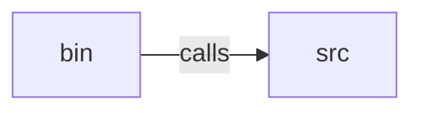

_Generated by CodeAtlas._

## Details

Owns 512 symbols across 17 file(s).

### bin

Owns 1 symbols across 1 file(s).

**Related Classes/Methods:** _None_

**Source Files:**

- `src/bin/cli.rs`
  - `src.bin.cli.main`
